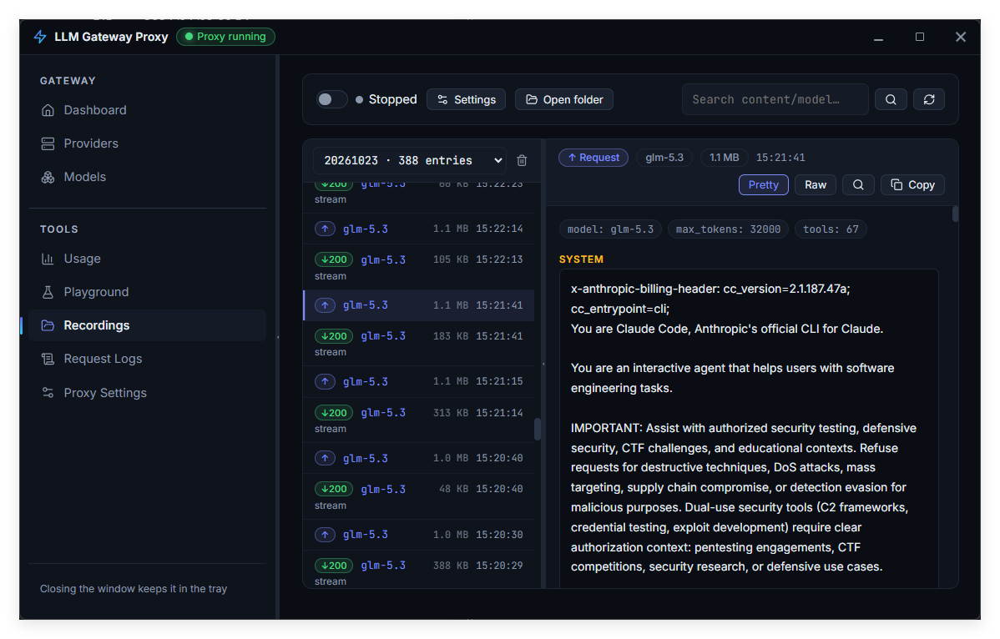
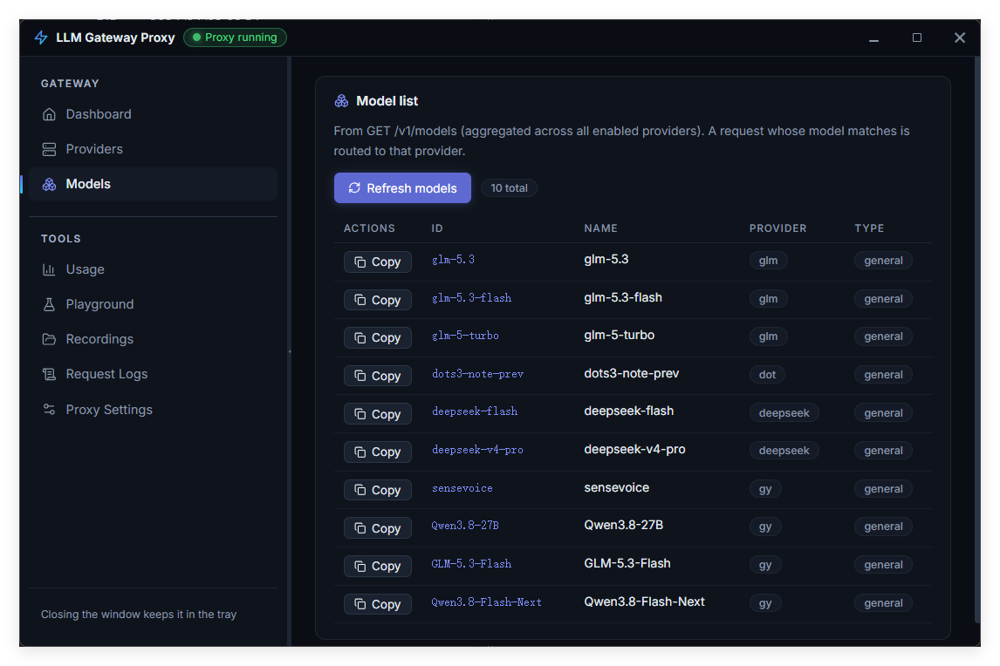
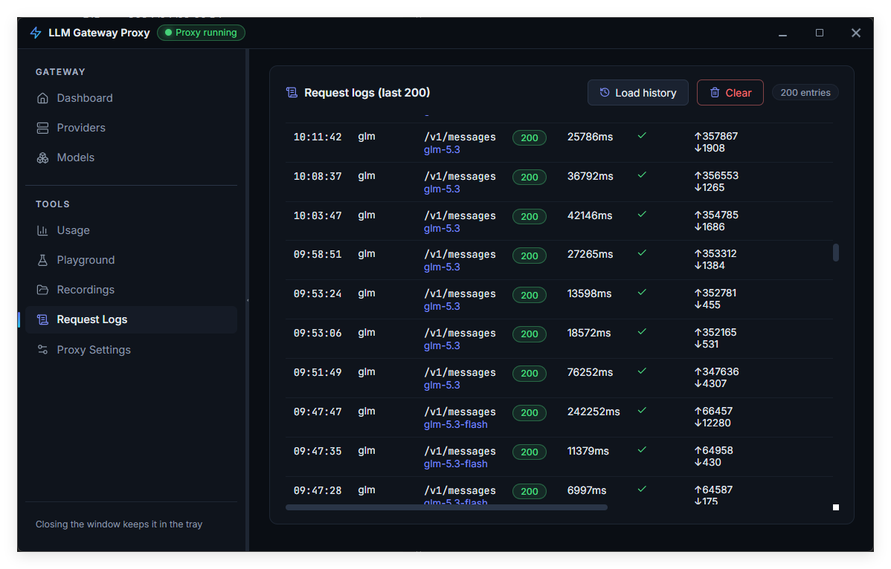
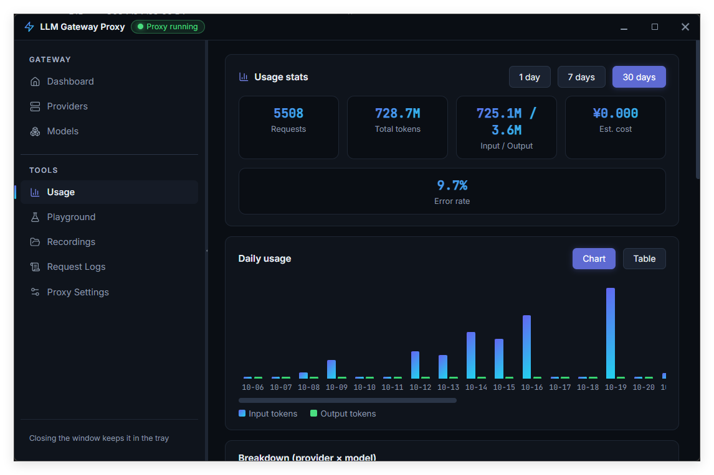

# LLMGatewayProxy

**One local gateway for LLM providers and API protocols.**

LLMGatewayProxy is a Windows desktop app that gives Claude Code, Codex, Zoo Code, compatible clients, SDKs, and scripts a single local API endpoint. Configure upstream providers once, then call them through familiar OpenAI, Anthropic, or OpenAI Responses APIs. The gateway translates protocols when the client and provider do not speak the same API.

[简体中文](README.md)

## Highlights

- **One endpoint, multiple providers** — supports OpenAI-compatible, Anthropic, and Gemini upstreams. Route requests by model name, configure a default provider, or explicitly select a provider.
- **Decouple clients from provider protocols** — exposes OpenAI Chat Completions, Anthropic Messages (including `count_tokens`), and OpenAI Responses endpoints. Cross-protocol requests, responses, and streams are translated through a shared OpenAI Chat representation.
- **Built for agent workflows** — supports tool calls and SSE streaming so compatible clients can use models behind different provider protocols.
- **Fail over before a response starts** — configure candidate models; on an upstream `429` or `5xx`, the gateway can try the next candidate if it has not started writing a response to the client.
- **Recording preview for every LLM exchange** — when recording is enabled, browse interactions by date and inspect each captured request and response in the desktop app. Review timestamps, models, status codes, protocol conversions, message and tool-call content, token usage, and SSE frames. Switch between formatted and raw views, search within an entry, and copy the original payload to understand exactly what went into and came back from the model.
- **A desktop control center** — manage providers, models, request logs, usage statistics, health status, and recordings; use the built-in Playground to test requests.
- **Lightweight background operation** — closing the window hides the app in the system tray. Single-instance behavior and launch-at-login are supported.
- **Free edition, without subscriptions or feature gating** — the `free` branch contains no payment or subscription flow and does not restrict features behind a subscription.

## How it works

```text
Claude Code / Codex / Zoo Code / SDK / curl
                    │
                    ▼
             Local LLMGatewayProxy
      API translation, routing, logs, metrics
                    │
          ┌─────────┼──────────┐
          ▼         ▼          ▼
   OpenAI-compatible Anthropic  Gemini
```

Point a client at a supported endpoint and pass a model name. The gateway routes the request using the configured model list. If the client and upstream use different protocols, it translates requests, responses, and streaming events.

## Supported endpoints

| Client endpoint | API |
|---|---|
| `POST /v1/chat/completions` | OpenAI Chat Completions |
| `POST /v1/messages` | Anthropic Messages |
| `POST /v1/messages/count_tokens` | Anthropic token counting |
| `POST /v1/responses` | OpenAI Responses |
| `GET /v1/models` | List models routable through the gateway |

Upstreams can use OpenAI-compatible, Anthropic, or Gemini APIs. Cross-protocol translation covers regular requests and responses, tool calls, and SSE streams.

## Download and run

### Windows

Requirements: Windows 10/11 x64 and the WebView2 Runtime. App data is stored under `%APPDATA%\LLMGatewayProxy\`.

If a prebuilt release is available on the project release page, download and run `LLMGatewayProxy.exe`; the frontend is bundled in the executable.

### Version checks and update notices

Release builds can inject the application version, report-signing key, and Cloudflare Worker version-service URL through Wails linker flags. On startup, the app asynchronously checks for updates and signs reports containing its version and OS/architecture. Cloudflare supplies the source IP; the service aggregates by day, version, platform, and IP, retaining raw IP values indefinitely. Reports do not include a device ID, API key, or conversation content. An in-app banner appears only when a newer version is available; network failures do not block startup.

```powershell
wails build -ldflags "-X main.Version=1.2.3"
```

For release builds, inject a random signing secret of at least 32 bytes from a controlled secret manager and configure the same value as the Worker secret. The key is embedded in the distributed binary and can be extracted; HMAC with timestamp and nonce provides basic forgery/replay deterrence, not strong client identity. Without the key, the app skips reporting but continues checking for updates. The default version service is [llmgate.yongyitec.com](https://llmgate.yongyitec.com). Override it with `-X main.VersionServiceURL=https://<your-worker-domain>` if needed. See the [marketing site deployment guide](../llm-gateway-proxy-free-web/README.md) for Worker setup and release configuration.

### Build from source

Install Go 1.25, Node.js/npm, and the Wails v2 CLI:

```powershell
npm --prefix frontend ci
wails dev
```

Build the desktop application:

```powershell
wails build
```

The output is `build\bin\LLMGatewayProxy.exe`. Use `wails build` to package the frontend; running `go build` alone does not embed the frontend assets.

Run backend tests:

```powershell
go test ./...
```

## Quick start

1. Launch the app and add an upstream in **Providers**: choose its protocol, then enter the Base URL, API key, and model list.
2. Verify routable model names in **Models**. Optionally select a default provider for model names that do not match a configured list.
3. Check the bind address and port in **Proxy Settings**. The default is `127.0.0.1:8717`; the local API key is unset by default.
4. Point your client to the local gateway and use the matching client API protocol.

OpenAI-compatible client example:

```bash
curl http://127.0.0.1:8717/v1/chat/completions \
  -H "Content-Type: application/json" \
  -H "x-api-key: YOUR_LOCAL_KEY" \
  -d '{
    "model": "YOUR_MODEL_NAME",
    "messages": [{"role": "user", "content": "Hello"}],
    "stream": true
  }'
```

If no local API key is configured, omit the `x-api-key` header. When enabled, OpenAI-compatible clients can send the local key in the `x-api-key` or `Authorization` header; Anthropic clients provide it using their usual API-key mechanism.

### Claude Code

Point Anthropic API requests to the proxy (port `8717` by default) and use the local API key if one is configured. The client calls `/v1/messages`; the gateway routes the request to the configured upstream based on the model.

See [DEPLOY.md](DEPLOY.md) for additional client examples and WSL connection instructions.

## Management and observability

- **Request logs** — inspect routing, model, latency, and token usage.
- **Usage statistics** — aggregate usage by date, provider, and model; configure pricing rules to estimate cost.
- **Health monitoring** — periodically checks provider model-list APIs without sending chat messages.
- **Recording preview** — when enabled, browse each recorded LLM request and response by date, including model, timestamp, status, protocol conversion, message/tool-call details, and SSE frames. Switch between formatted and raw views, search entries, and copy the original payload. Recordings are stored in daily files and removed according to the retention period.
- **Playground** — send requests from the desktop UI to validate the full proxy path.

## Screenshots

The screenshots below show the model list, request logs, usage statistics, and the recording preview for inspecting individual LLM exchanges.

### Recording preview: inspect every LLM exchange



### Model list



### Request logs



### Usage statistics



## Security and privacy

- The gateway listens on `127.0.0.1` by default. If you bind to `0.0.0.0` for WSL or LAN access, set a local API key and configure your firewall.
- On Windows, provider and local API keys are encrypted at rest with DPAPI for the current Windows user. Do not share the application data directory.
- Recordings may contain prompts, tool arguments, and model responses. Before enabling recording, make sure your data handling meets your privacy and compliance requirements, and protect the resulting files.
- Follow the terms of service, rate limits, and data policies of your upstream providers.
