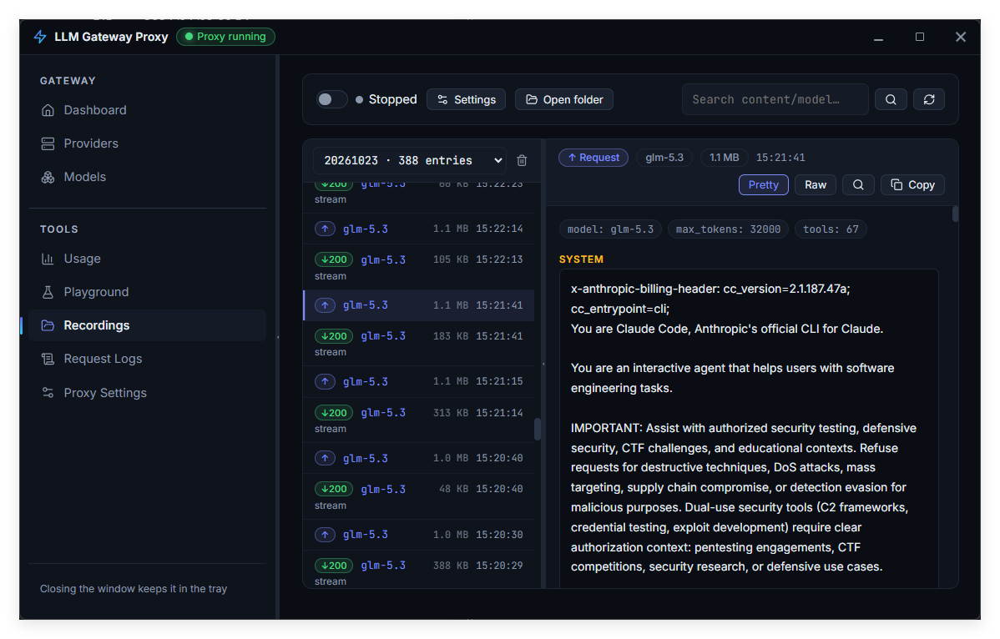
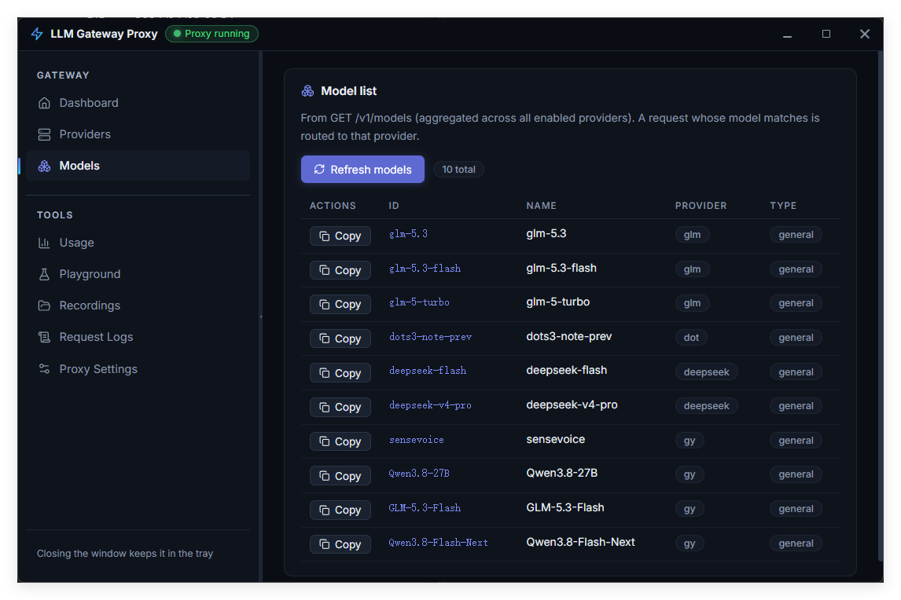
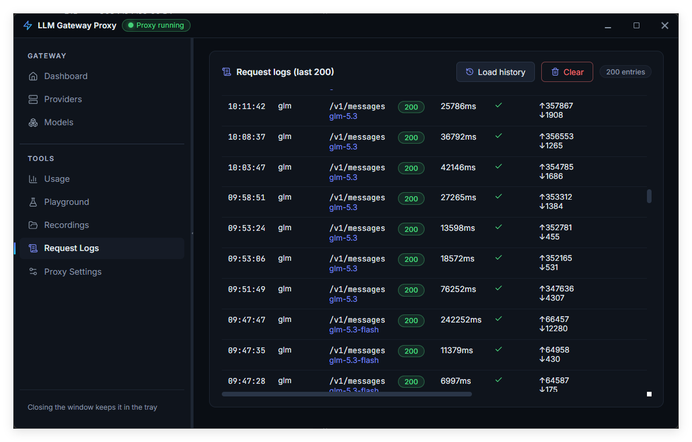
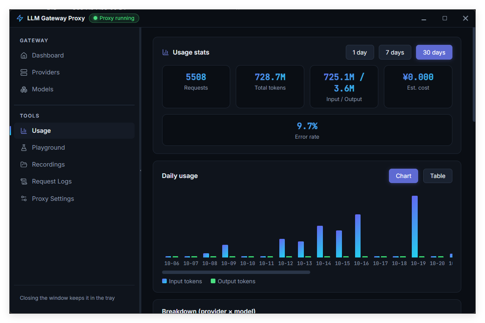

# LLMGatewayProxy

**把不同厂商、不同 API 协议的 LLM 接入统一到一个本地网关。**

LLMGatewayProxy 是一款面向 Windows 的桌面应用，为 Claude Code、Codex、Zoo Code、其他兼容客户端以及自建脚本提供统一的本地 API 入口。配置一次上游厂商，客户端即可通过熟悉的 OpenAI、Anthropic 或 OpenAI Responses 接口调用模型；需要跨协议时，由网关自动完成转换。

[English](README.md)

## 项目亮点

- **一个本地入口，接入多家上游**：支持 OpenAI 兼容、Anthropic 和 Gemini 上游；按请求中的模型名路由到对应厂商，也可以配置默认厂商或显式指定厂商。
- **客户端与上游协议解耦**：提供 OpenAI Chat Completions、Anthropic Messages（包括 `count_tokens`）和 OpenAI Responses 接口。异构协议通过统一的 OpenAI Chat 中间表示进行请求、响应和流式转换。
- **适配 Agent 工作流**：支持工具调用和 SSE 流式响应，让不同协议的客户端可以使用兼容的上游模型。
- **故障转移不中断请求**：可配置候选模型；遇到上游 `429` 或 `5xx` 且尚未向客户端发送响应内容时，网关可继续尝试后续候选。
- **录制预览，逐条查看 LLM 交互细节**：开启录制后，在桌面端按日期浏览每次记录的请求与响应；查看时间、模型、状态码、协议转换和流式标记。支持格式化对话视图与原始内容切换，可检查消息内容、工具调用、Token 用量及 SSE 帧，搜索并复制完整原文，便于排查 Agent 的实际输入输出。
- **桌面管理，不只是一个代理进程**：可视化管理厂商、模型、请求日志、用量统计、健康状态和录制；提供 Playground 便于直接验证调用。
- **轻量常驻**：窗口关闭后驻留系统托盘，支持单实例和开机自启；代理在本机后台持续服务。
- **免费版无订阅与功能限制**：`free` 分支不包含支付/订阅流程，也不通过订阅限制功能。

## 工作方式

```text
Claude Code / Codex / Zoo Code / SDK / curl
                    │
                    ▼
             本地 LLMGatewayProxy
         API 兼容、协议转换、路由、日志
                    │
          ┌─────────┼──────────┐
          ▼         ▼          ▼
     OpenAI 兼容   Anthropic   Gemini
```

客户端选择网关支持的 API 端点，并在请求中传入模型名。网关根据已配置的模型列表进行路由；当客户端协议和上游协议不同时，自动转换请求、响应以及流式事件。

## 支持的接口

| 客户端接口 | 用途 |
|---|---|
| `POST /v1/chat/completions` | OpenAI Chat Completions |
| `POST /v1/messages` | Anthropic Messages |
| `POST /v1/messages/count_tokens` | Anthropic Token 计数 |
| `POST /v1/responses` | OpenAI Responses |
| `GET /v1/models` | 查看网关可路由的模型 |

上游支持 OpenAI 兼容、Anthropic 和 Gemini。协议转换覆盖常规请求/响应、工具调用及 SSE 流式响应。

## 获取与运行

### Windows 用户

系统要求：Windows 10/11 x64，以及 WebView2 Runtime。应用数据保存在 `%APPDATA%\LLMGatewayProxy\`。

若项目发布页提供预构建版本，下载并运行 `LLMGatewayProxy.exe` 即可，无需单独安装前端。

### 版本检查与升级提示

发布构建可通过 Wails linker flags 注入版本号、版本上报签名密钥与 Cloudflare Worker 版本服务地址。应用启动时异步检查更新，并签名上报版本号和系统/架构。Cloudflare 提供来源 IP，服务端按日、版本、平台和 IP 汇总；不收集设备 ID、API Key 或对话内容。仅发现更高版本时显示应用内提示条，检查失败不会影响启动。

```powershell
wails build -ldflags "-X main.Version=1.2.3"
```

正式发布需通过受控密钥管理器向 `VERSION_REPORT_SECRET` 注入至少 32 字节随机密钥，并在 Worker secret 中设置相同值。密钥会随客户端二进制分发，可能被提取；HMAC 时间戳和 nonce 仅提供基础防伪造/重放能力，不是强客户端身份认证。未配置密钥时客户端跳过上报，但仍检查更新。默认版本服务地址为 [llmgate.yongyitec.com](https://llmgate.yongyitec.com)。如需切换服务地址，可额外传入 `-X main.VersionServiceURL=https://<your-worker-domain>`。Worker 初始化与发布配置见 [推广站部署说明](../llm-gateway-proxy-free-web/README.md)。

### 从源码构建

需要 Go 1.25、Node.js/npm 和 Wails v2 CLI：

```powershell
npm --prefix frontend ci
wails dev
```

构建桌面应用：

```powershell
wails build
```

构建产物为 `build\bin\LLMGatewayProxy.exe`。请使用 `wails build` 完成打包；单独运行 `go build` 不会嵌入前端资源。

运行后端测试：

```powershell
go test ./...
```

## 快速开始

1. 启动应用，在“厂商管理”中添加上游：选择协议类型，填写 Base URL、API Key 和模型列表。
2. 在模型页确认可路由的模型名称；如需未匹配模型的默认路由，在设置中选择默认厂商。
3. 在“代理设置”中确认监听地址和端口。默认地址为 `127.0.0.1:8717`，本地 API Key 默认未设置。
4. 将客户端 Base URL 指向本地网关，并使用相应 API 协议。

OpenAI 兼容客户端示例：

```bash
curl http://127.0.0.1:8717/v1/chat/completions \
  -H "Content-Type: application/json" \
  -H "x-api-key: YOUR_LOCAL_KEY" \
  -d '{
    "model": "YOUR_MODEL_NAME",
    "messages": [{"role": "user", "content": "Hello"}],
    "stream": true
  }'
```

如果没有为本地代理设置 API Key，可移除 `x-api-key` 请求头。若启用本地 API Key，OpenAI 兼容客户端可通过 `x-api-key` 或 `Authorization` 请求头传入；Anthropic 客户端按其协议提供 API Key。

### Claude Code

将 Anthropic API 请求指向代理地址（默认端口 `8717`），并将 API Key 设置为代理的本地 Key（如果已启用）。客户端调用 `/v1/messages`，网关再按模型路由到配置的上游。

更多客户端配置示例及 WSL 连接说明见 [DEPLOY.md](DEPLOY.md)。

## 管理与可观测性

- **请求日志**：查看调用的路由、模型、耗时和 Token 用量。
- **用量统计**：按日期、厂商和模型聚合用量，并可配置计价规则估算成本。
- **健康监控**：通过上游模型列表接口定期探测厂商状态，不发送对话消息。
- **录制预览**：开启录制后，按日期逐条查看每次 LLM 请求与响应的详情，包括模型、时间、状态、协议转换、消息/工具调用内容和流式 SSE 帧；支持格式化/原始视图、搜索及复制原文。录制按天保存并按保留期清理。
- **Playground**：直接从桌面界面发起请求，检查端到端代理链路。

## 界面预览

以下截图展示模型列表、请求日志、用量统计，以及录制预览中逐条查看 LLM 交互详情的界面。

### 录制预览：查看每次 LLM 交互



### 模型列表



### 请求日志



### 用量统计



## 安全与隐私

- 默认只监听 `127.0.0.1`。若改为 `0.0.0.0` 以供 WSL 或局域网访问，请务必设置本地 API Key，并配置好防火墙。
- Windows 上，厂商 API Key 和本地 API Key 使用当前 Windows 用户的 DPAPI 加密后保存。不要将应用配置目录分享给他人。
- 请求录制可能包含提示词、工具参数及模型响应；启用前确认数据处理符合你的隐私与合规要求，并妥善保护录制文件。
- 请自行遵守上游厂商的服务条款、速率限制和数据使用政策。
